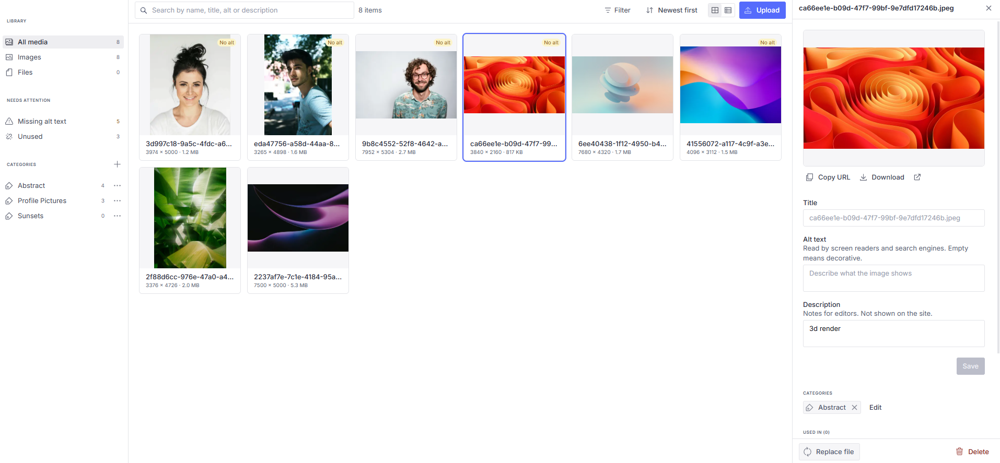
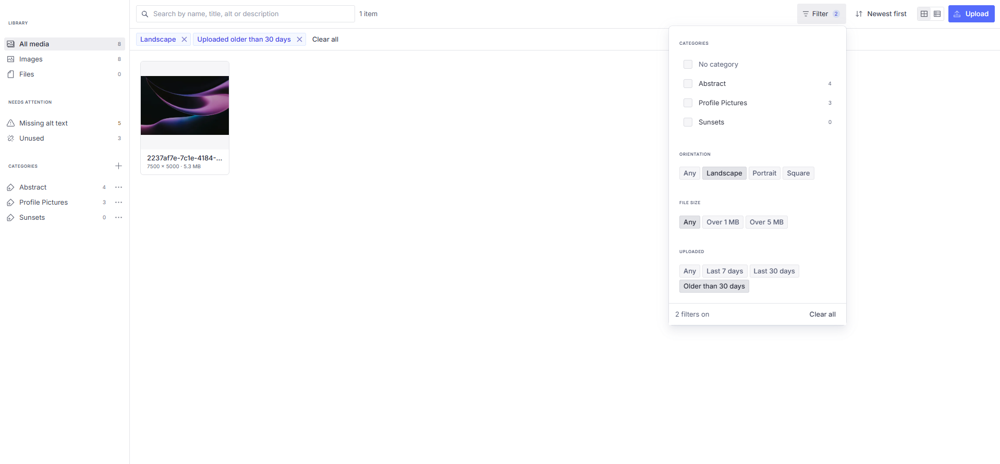
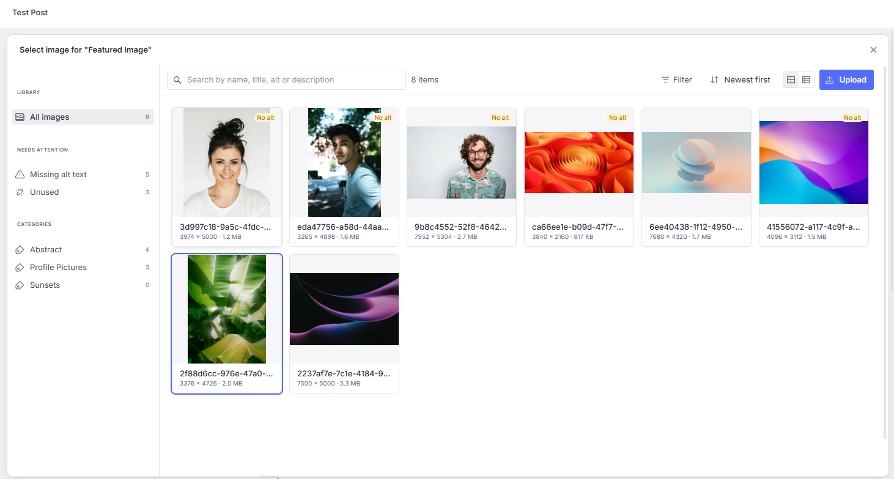

# @unseenco/sanity-plugin-better-media

A media library for Sanity Studio. Browse, search and filter every image and file, upload by drag and drop, sort assets into categories, write alt text, see where each asset is used, replace a file everywhere at once, and clean up what nothing uses. The same browser opens from image and file fields to pick an asset.

It reads and writes the same data as [sanity-plugin-media](https://github.com/sanity-io/sanity-plugin-media), so you can switch with nothing to migrate.



| Filters                                                                                                   | Picking for a field                                                                     |
| --------------------------------------------------------------------------------------------------------- | --------------------------------------------------------------------------------------- |
|  |  |

## Features

- **Browse** images and files in a grid or list, newest, oldest, by name or largest first, with live updates as anyone edits.
- **Search** file names, titles, alt text and descriptions.
- **Filter** by type (JPG, PNG, PDF…), categories (several, matching any or all, or "No category"), orientation, file size and upload date. Active filters show as removable chips.
- **Needs attention** views: images missing alt text, and assets no document uses (drafts and release versions count as uses).
- **Upload** with the button or by dropping files anywhere on the library. With one category showing, uploads go into it.
- **Asset panel**: a large preview, copy URL, download, title, alt text, description, categories, file details and **Used in**, the documents that use the asset, each linking to it.
- **Replace file** everywhere it's used: the new file takes over the title, alt text, description and categories, and every published document, draft and release version that used the old one is moved onto it in one transaction.
- **Bulk actions**: tick assets (shift-click for a run) to add them to or remove them from categories, or delete them. Assets still in use are never deleted.
- **Categories**: create, rename and delete from the sidebar or straight from an asset.
- **Picker** for image and file fields, with the current asset highlighted.
- Follows the Studio's light and dark themes, and adapts to narrow panes.

## Installation

```sh
npm install @unseenco/sanity-plugin-better-media
```

Requires Sanity Studio v5 and React 19.

## Usage

```ts
// sanity.config.ts
import {defineConfig} from 'sanity'
import {betterMedia} from '@unseenco/sanity-plugin-better-media'

export default defineConfig({
  // ...
  plugins: [betterMedia()],
})
```

That adds a **Media** tool to the Studio's top bar, a **Media** option to every image and file field's asset menu, and the `media.tag` type for categories.

### Options

```ts
betterMedia({
  // The tool in the top bar, or false to leave it out
  tool: {name: 'media', title: 'Media'},
  // The picker on image and file fields, or false to leave it out
  assetSource: {title: 'Media', images: true, files: true},
})
```

### Choosing asset sources yourself

To decide which sources each field type offers, filter them in your config. The plugin's source is named `better-media`:

```ts
form: {
  image: {
    // Only this library (and drop Sanity's default uploaded-images browser)
    assetSources: (prev) => prev.filter((source) => source.name === 'better-media'),
  },
},
```

## Data

| Field                             | On                                                  | What                                      |
| --------------------------------- | --------------------------------------------------- | ----------------------------------------- |
| `title`, `altText`, `description` | The asset (`sanity.imageAsset`, `sanity.fileAsset`) | Sanity's own asset fields                 |
| `opt.media.tags`                  | The asset                                           | Weak references to the asset's categories |
| `name.current`                    | `media.tag` documents                               | A category's name                         |

Alt text lives on the asset, so it's shared by every use of an image. Fetch it with the image:

```groq
*[_type == "post"]{
  image{
    ...,
    "altText": asset->altText
  }
}
```

## Switching from sanity-plugin-media

1. `npm uninstall sanity-plugin-media`, then `npm install @unseenco/sanity-plugin-better-media`.
2. Replace `media()` with `betterMedia()` in `sanity.config.ts`, and `mediaAssetSource` with a check for `source.name === 'better-media'` in any asset source filters.

Your alt text, titles, descriptions and tags (now called categories) carry over as they are. Don't install both plugins: they both define the `media.tag` type, and the Studio won't start.

## Notes

- **Replacing a file**: Sanity assets can't change their file, so Replace uploads a new asset and moves every reference onto it. If an image's dimensions change, you're warned to check crops and hotspots where it's used.
- **Unused** counts references across the dataset. That's quick on most datasets; on very large ones that view can take a moment.

## License

[MIT](LICENSE) © jake whiteley

## Develop & test

This plugin uses [@sanity/plugin-kit](https://github.com/sanity-io/plugins/tree/main/packages/@sanity/plugin-kit) with its default build and watch scripts.

- `npm run build` builds `dist/` (and checks the package).
- `npm run watch` rebuilds on every change.
- `npm run lint` / `npm run format` run oxlint / oxfmt.

To work on it inside a Studio without publishing, install it from its folder (`npm install ../sanity-plugin-better-media`) and run `npm run watch` here. Use `watch` rather than `build` while the Studio runs: `build` deletes and recreates `dist/`, after which the Studio's dev server keeps serving the old build until it's restarted. Add `sanity`, `react`, `react-dom` and `styled-components` to `resolve.dedupe` in the Studio's `sanity.cli.ts` (`vite` option), so the linked plugin uses the Studio's copies rather than its own. Don't add `@sanity/ui` or `@sanity/icons`: Studio dependencies rely on their own nested versions of those, and deduping them stops the dev server starting. See [Testing a plugin in Sanity Studio](https://github.com/sanity-io/plugins/tree/main/packages/@sanity/plugin-kit#testing-a-plugin-in-sanity-studio) for the yalc alternative.
